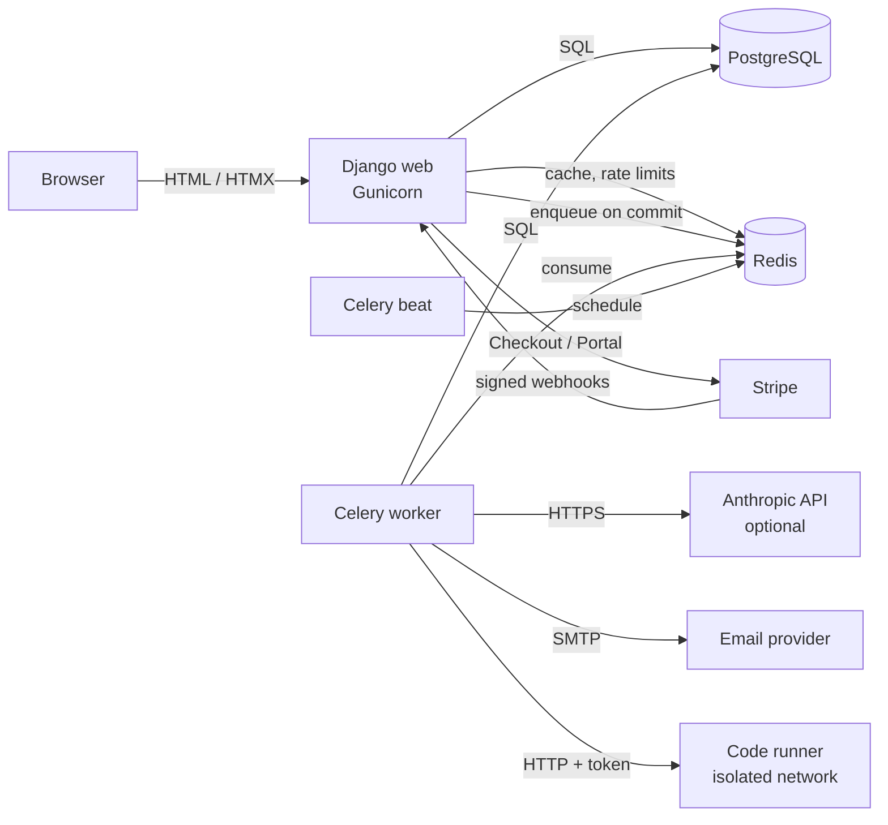
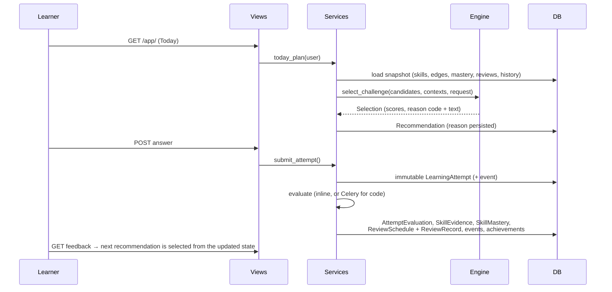

# Architecture

SkillForge is a **modular Django monolith**. There are no microservices except one deliberate exception: the
code-execution sandbox, which must be isolated from application credentials and the database.

## Module boundaries

| Package | Responsibility | Depends on |
|---|---|---|
| `apps.engine` | Pure decision logic: mastery model, scheduler, graph, eligibility, difficulty, selection, explanations, streaks. **Imports no Django models**, so every rule is unit-testable with plain dataclasses. | — |
| `apps.evaluation` | Deterministic evaluators keyed by challenge kind; the HTTP client for the sandbox. Pure functions of (content, response). | — |
| `apps.catalog` | Curriculum models, YAML loader/validator (no DB needed), idempotent seeding, skill-map layout, explorer views. | engine, evaluation |
| `apps.learning` | Learner state and history; **services** that load data, call the engine/evaluators and persist results; views; Celery tasks. | catalog, engine, evaluation |
| `apps.accounts` | Custom user (email login), profile/preferences, auth flows, settings, deletion. | — |
| `apps.onboarding` | Resumable wizard; placement check uses the real submission service. | learning |
| `apps.mentor` | Provider abstraction, context building, curated fallback, quotas. | learning, billing |
| `apps.notifications` | Notifications, reminder scheduling, email delivery. | — |
| `apps.billing` | Plans/entitlements, usage quotas, provider adapters, webhooks. | — |
| `apps.core` | Middleware, logging, rate limiting, health, markdown, template tags, cleanup. | — |

Views stay thin: they validate input, call a service and render. Business rules live in `services/` (Django-aware
orchestration) or `engine/` (pure logic). Templates contain no business logic.

## The adaptive loop

Key properties:

* **One recommendation at a time.** Only the next recommendation is materialised; after each attempt the
  following pick uses the newest evidence (so “the next recommendation reflects the updated learner state”).
* **Immutability.** Attempts reject changes to their response; challenge and path content is versioned and a
  version that has been attempted cannot be edited.
* **Idempotency.** Evaluation writes under a row lock; `SkillEvidence (attempt, skill)` and
  `ReviewRecord (attempt)` are unique, so retried tasks can't double-apply. Notifications are unique per
  `(user, dedupe_key)`; webhook events per `(provider, event_id)`.
* **No external call inside a transaction.** The sandbox and AI providers are called outside DB transactions;
  results are then written atomically. Work is dispatched with `transaction.on_commit`.

## Frontend

* Django templates with a small component set (`templates/components`), HTMX for partial updates (hints,
  solution reveal, skip, mentor, settings forms, history and skill filters, notifications, evaluation polling).
* Tailwind CSS v4 with a CSS-first design system (`frontend/app.css`): semantic `--sf-*` colour tokens for the
  ivory light theme (default), a deep-green dark theme and "match system", plus scoped token sets for deep-green
  surfaces (`.surface-royal`) and dark code blocks; DM Serif Display headings over Inter, typography scale,
  components, motion. Fonts and assets are built locally; no CDN dependency.
* Plain JavaScript (`static/js/app.js`) for theme switching, drawers, menus, toasts, autosave and unsaved-work
  protection, charts and skill-map highlighting. No `eval`, so a strict CSP (`script-src 'self' 'nonce-…'`)
  applies. Alpine.js was not needed.
* CodeMirror 6 (bundled with esbuild) progressively enhances the code textarea; Chart.js renders analytics, with
  tabular alternatives.

## Background jobs

| Task | Schedule | Notes |
|---|---|---|
| `learning.prepare_daily_sessions` | hourly :05 | Pre-builds the first recommendation at ~04:00 local time. Optional optimisation; idempotent. |
| `notifications.send_daily_reminders` | hourly :00 | Users whose local hour = reminder hour, reminders on, no practice today. Deduplicated per local day. |
| `notifications.send_review_reminders` | hourly :30 | Only when reviews are due. Deduplicated per local day. |
| `notifications.deliver_notification_email` | on demand | Claims the row before sending; exponential backoff; never resends a sent email. |
| `learning.evaluate_attempt_task` | on demand | Code submissions; retries while the runner is busy or down. |
| `learning.retry_pending_evaluations` | every 10 min | Re-dispatches queued attempts after an outage. |
| `mentor.run_mentor_request_task` | on demand | Transient provider errors retry, then fall back to curated guidance. |
| `billing.expire_lapsed_subscriptions` | daily 03:15 UTC | Downgrades cancelled plans after their paid period. |
| `core.cleanup_stale_data` | daily 04:00 UTC | Expired sessions, stale drafts/recommendations, old read notifications. Never deletes learning history. |

Failures after retries are logged and recorded in `core.TaskFailure` (visible in the admin).

## Architectural decisions

| Decision | Rationale |
|---|---|
| Monolith + one sandbox service | Simplest thing that works; the sandbox is separate purely for isolation. |
| Deterministic evaluation; AI only explains | Scores must be reproducible and cheap; LLM output can't change mastery. |
| Pure engine package | Testability and replaceability (models are versioned and selected by `get_model()` / `get_scheduler()`). |
| Custom auth instead of django-allauth | Full control of UX and templates with few moving parts; Django's own token generators and auth views do the security-critical work. |
| No Django REST Framework | No public API is needed yet: HTMX consumes HTML partials and the only machine endpoints are webhooks and health checks. |
| No Alpine.js | The interactions needed are small; vanilla JS keeps the CSP strict. |
| SQLite for development, PostgreSQL for production | Only portable ORM features are used (partial unique indexes and check constraints work on both); CI runs the suite on PostgreSQL. |
| Curated, versioned curriculum in YAML | Reviewable in pull requests, validated before seeding, safe to re-seed. |
| Fixed-window cache rate limiter | Small, testable, Redis-backed in production. |
